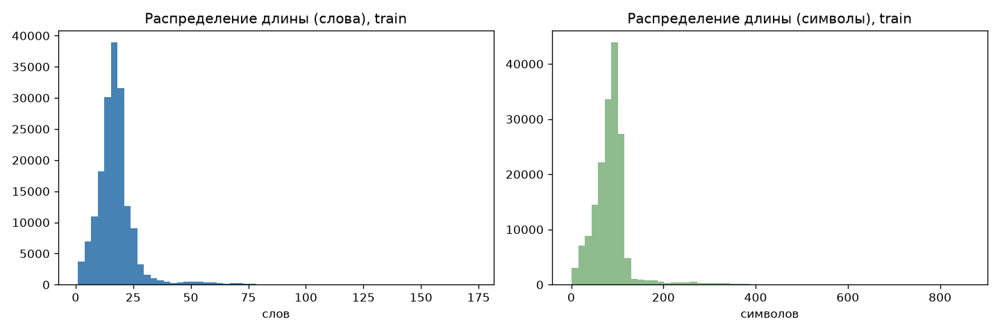
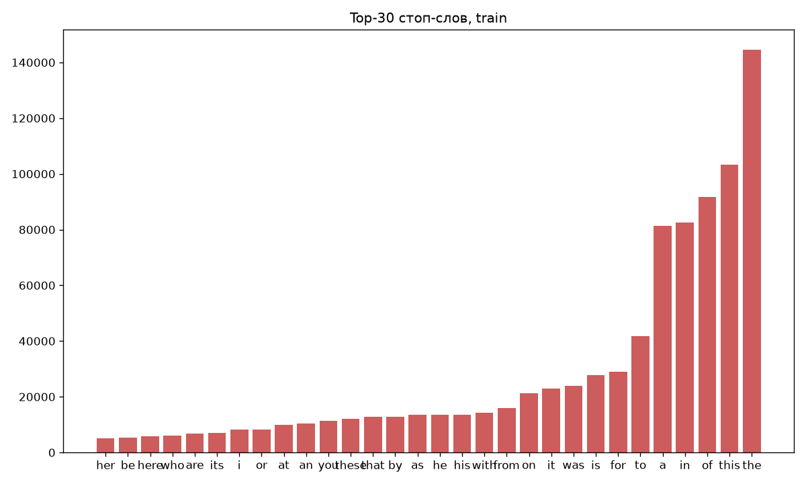

# NLP лаб

Проект лабораторных по NLP; общее uv-окружение, каждая лаба - в своей директории
(`lab1/`, `lab2/`, ...): код - в `lab1/source/`, ноутбук - в `lab1/`,
артефакты - в `lab1/output/`.

## Лабораторная работа №1 - классический NLP на датасете Jeopardy

Отчёт по 9 пунктам задания. Код - пакет `lab1/source`:
`data.py` (п.1–2) · `clean.py` (п.3–4) · `normalize.py` (п.5) ·
`levenshtein.py` (п.6) · `lm.py` (п.7–9) · `main.py` (оркестратор).
Интерактивная версия: [`lab1.ipynb`](lab1.ipynb).

```bash
source /home/miryz/projects/nlp/.venv/bin/activate
uv run python -m lab1.source.main   # запуск из корня проекта, общее uv-окружение
```


## Датасет

`datasets/jeopardy.csv` - **216 930** строк шоу Jeopardy.:

| Show Number | Air Date | Round | Category | Value | Question | Answer |
|---|---|---|---|---|---|---|
| 4680 | 2004-12-31 | Jeopardy! | HISTORY | $200 | For the last 8 years of his life, Galileo was under house arrest for espousing this man's theory | Copernicus |
| 4680 | 2004-12-31 | Jeopardy! | ESPN's TOP 10 ALL-TIME ATHLETES | $200 | No. 2: 1912 Olympian; football star at Carlisle Indian School; 6 MLB seasons with the Reds, Giants & Braves | Jim Thorpe |
| 4680 | 2004-12-31 | Jeopardy! | EVERYBODY TALKS ABOUT IT... | $200 | The city of Yuma in this state has a record average of 4,055 hours of sunshine each year | Arizona |

Целевая колонка - **`Question`**: именно она моделируется языковой моделью
(`Answer` - короткая сущность, вторична). Заголовки CSV содержат ведущие пробелы →
`df.columns = [c.strip() ...]`; пустых `Question` в файле нет (`dropna` страховочный).


## Пункт 1. Сплит 80/20 со стратификацией

Метки класса у датасета нет → страта по **`Round`** (задаёт распределение длины и
стиля вопросов - сохраняет именно текстовую структуру корпуса).

| | документов | состав |
|---|---|---|
| **train** | **173 544** | Jeopardy! 85 907 · Double! 84 730 · Final! 2 905 · Tiebreaker 2 |
| **test** | **43 386** | та же пропорция (stratify=Round, seed=42) |

## Пункт 2. EDA (только train)

- Средняя длина: **17.49 слов / 86.22 символов**.
- Распределение правостороннее: мода ≈ 10–18 слов, хвост до 50+.



- Топ стоп-слов: `the, a, of, to, in, this, is, that` - корпус = обычная
  английская проза, подходит для классической n-граммной модели.



## Пункт 3. Доменные шумы (аудит regex'ом по train)

| тип | пример из корпуса | документов | доля |
|---|---|---|---|
| HTML-теги | `The <b>cc</b> on an office letter…` | 8 576 | 4.9% |
| URL | `<a href="http://www.j-archive.com/…mp3">Beyond ovoid…</a>` | 8 504 | 4.9% |
| числа / деньги | `…given him a $10,000 contract` | 73 609 | **42.4%** |
| смайлики | `:-$ It's where this emoticon tells you…` | 9 754 | 5.6% |
| повторная пунктуация | `EPITAPHS & TRIBUTES: "…you are a credit…"` / `!!!` `???` | 3 123 | 1.8% |
| «умные» кавычки (U+2018…") | `the \u201cArt Linkletter Show\u201d` | 442 | 0.3% |
| HTML-сущности `&amp;` | - | 25 | 0.015% (почти нет) |

Природа шумов - доменная специфика TV-шоу: экранная разметка (жирный/переносы),
озвучка денег ведущим, ссылки-подсказки, категория «EMOTICONS».
Значимые типы (≥3, доказаны долей): **HTML-разметка, URL, числа/деньги**.
HTML-сущности - доказательство *отсутствия* (25 строк), но правило для них нужно.

## Пункт 4. Конвейер чистки (по правилу на тип шума)

| # | правило | было → стало |
|---|---|---|
| 1 | `html.unescape` | `&amp;` → `&` |
| 2 | якорь `<a href="http://…">текст</a>` → `[URL] текст` (ДО вырезания тегов) | `<a href="http://…mp3">Beyond ovoid</a>` → `[URL] Beyond ovoid` |
| 3 | URL → `[URL]`; оставшиеся теги → пробел | `<b>bold</b>` → `bold` |
| 4 | смайлики → `[EMOJI]` | `:-$ It's where…` → `[EMOJI] It's where…` |
| 5 | числа/деньги → `[NUM]` | `a $10,000 contract` → `a [NUM] contract` |
| 6 | smart-кавычки → ASCII | `"…"` → `"…"` |
| 7 | `!!!` `???` `...` → `[ELLIPSIS]` | `TALKS ABOUT IT...` → `TALKS ABOUT IT [ELLIPSIS]` |
| 8 | прочий мусор, схлоп пробелов | |
| 9 | сентинели предложений | → `<s> The cc on an office letter refers back to this now little-used office supply </s>` |

Шум **заменяется токеном-заполнителем**, а не удаляется: модель видит *наличие*
шума в контексте (`[NUM]` предсказуем в денежных категориях).
Токенизация - `nltk.word_tokenize` (punkt). Итог train: **2 851 278 токенов**.

## Пункт 5. Стемминг vs лемматизация (размер словаря train)

| метод | словарь | сжатие | примеры |
|---|---|---|---|
| без нормализации | **125 833** | - | running, studies, better |
| PorterStemmer | **106 074** | **−15.7%** | `run`, `studi`, `better` |
| WordNetLemmatizer + POS | **116 167** | **−7.7%** | `running→run`, `studies→study`, `better→good` |

- Стемминг (эвристическая обрезка суффиксов) сжимает сильнее, но порождает
  не-слова (`studi`) и сливает разные слова (`university/universe → univers`).
- Лемматизация словарна (WordNet) + требует POS-тег (маппинг N/V/A/R → n/v/a/r;
  без тега ищет только существительные) - даёт настоящие слова, но сжимает слабее.

**Вывод:** для сокращения словаря/разреженности - стемминг; для семантики и
интерпретируемости - лемматизация.

## Пункт 6. Расстояние Левенштейна (своя реализация)

Классическое ДП, память - только «предыдущая строка», вектор ведём по более
короткой строке → **O(min(n,m))**:

$$
D_{i,j} = \min\!\big(D_{i-1,j}+1,\;\; D_{i,j-1}+1,\;\; D_{i-1,j-1}+(a_i \neq b_j)\big)
$$

Сравнение топ-800 частотных слов (нижний регистр; прунинг $|{|a|}-{|b|}| \le 2$):
**424 пары с d=1**, **3 745 пар с d=2**.

| пара (d=1) | частоты | характер |
|---|---|---|
| this ↔ his | 103k × 14k | усечение начала (function words) |
| the ↔ she | 137k × 4k | слова-близнецы |
| was ↔ has | 23k × 5k | опечаточный кандидат |
| name ↔ named | 9k × 4.5k | морфология (d=1 суффикс) |

**Вывод:** d=1 среди коротких частотных слов - это морфологические близнецы
английского, а не опечатки; реальные опечатки ищутся с d=1–2 среди редких
длинных слов.

## Пункт 7. Триграммная модель (N=3; N=2 = её bigram-слой)

Явные счётчики `uni / bi / tri` на очищенном train (с `<s>`, `</s>`):

$$
P(w_3 \mid w_1 w_2) = \frac{c(w_1 w_2 w_3)}{c(w_1 w_2)}
$$

- Словарь: **146 021** токен (включая `[URL] [NUM] [UNK]`, сентинели).
- OOV test-слов → токен **`[UNK]`**: **19 931** из 710 483 токенов test (2.8%).

## Пункт 8. Сглаживание и перплексия

Перплексия через лог-правдоподобие (база 2, N = 623 711 триграммных событий test):

$$
\mathrm{PPL} = 2^{-\frac{1}{N}\sum_{i}\log_2 P(w_i \mid w_1 w_2)}
$$

Две классики: **add-k (Лаплас)** и **stupid backoff (Ney et al., 2004)**:

$$
P_{\text{add-}k} = \frac{c(w_1w_2w_3)+k}{c(w_1w_2)+k\,V},
\qquad
P_{\text{SB}} =
\begin{cases}
c(w_1w_2w_3)/c(w_1w_2), & c>0\\
\alpha\,P(w_3\mid w_2) \to \alpha^2 P(w_3), & c=0
\end{cases}
$$

| модель | PPL (test) | нулевых событий |
|---|---:|---:|
| unigram baseline (справка ≈ эффективный словарь) | 2 015.39 | 0 |
| raw MLE (без сглаживания) | **3 869 756.31** | 384 162 / 623 711 |
| add-k, k = 1.0 (Лаплас) | 53 373.73 | 0 |
| add-k, k = 0.1 | 25 247.34 | 0 |
| add-k, k = 0.01 | 12 783.92 | 0 |
| **stupid backoff, α = 0.66** | **329.63** | 0 |

Выводы (по математике):

1. **MLE без сглаживания проваливается**: 61.6% unseen-контекстов → P=0 →
   произведение вероятностей обнуляется → PPL ≈ 4·10⁶. Эмпирика «нулевой проблемы».
2. **Add-k при V = 146 021 не спасает**: слагаемое $kV$ в знаменателе размывает
   массу почти равномерно; PPL растёт с k. Классика: add-k годен для малых
   алфавитов (POS, фонемы), не для 146K словаря.
3. **Stupid backoff - лучший**: нулей нет по построению (backoff до unigram),
   PPL **330** в **6.1 раз** ниже unigram-бейслайна (2 015) → модель реально
   использует контекст. Для больших редких корпусов backoff строго выигрывает
   count-based smoothing по правдоподобию.

## Пункт 9. Генерация марковской цепью

Старт `<s> <s>`, шаг - выбор из $P(\cdot \mid w_1 w_2)$; при пустом контексте
backoff на bigram → unigram. Стоп: `</s>` или max_len=30 (seed=42).
Артефакт: [`output/generated_texts.txt`](output/generated_texts.txt).

Реальные сэмплы (фрагменты артефакта):

> This novelist is the hardest substance in the sand it can also buy apple butter
> cake pie [NUM] feet high it lays an egg on top is made from jute

> [URL] Kelly of the only president inaugurated in Washington D.C. President
> Harding unveiled a statue of this dog called "Yorkie" for short provides
> support for a young male attendant at

**Оценка связности:** тексты семантически несвязны (ожидание для сырой триграммы
на разнородных категориях), но локально читаемы: схвачены клише Jeopardy!
(«this queen abdicated», «a Shakespeare play inspired by», «the novel "…"»),
модель правдоподобно имитирует *жанр формулировки вопроса*, включая токены шума
(`[NUM]`, `[EMOJI]`) в уместных местах. Локальная связность при глобальной
бессмыслице - характерный профиль марковской генерации.


## Итог

| метрика | значение |
|---|---|
| документов / сплит | 216 930 → 173 544 / 43 386 (80/20, stratify=Round) |
| EDA | 17.49 слов / 86.22 символов в среднем |
| словарь raw / stem / lemma | 125 833 / 106 074 (−15.7%) / 116 167 (−7.7%) |
| Левенштейн d=1 / d=2 | 424 / 3 745 пар |
| PPL: MLE → add-k(0.01) → stupid backoff | 3 869 756 → 12 784 → **330** (unigram-бейслайн 2 015) |

Конвейер полностью воспроизводится командой `uv run python -m lab1.source.main` (~70 с).
